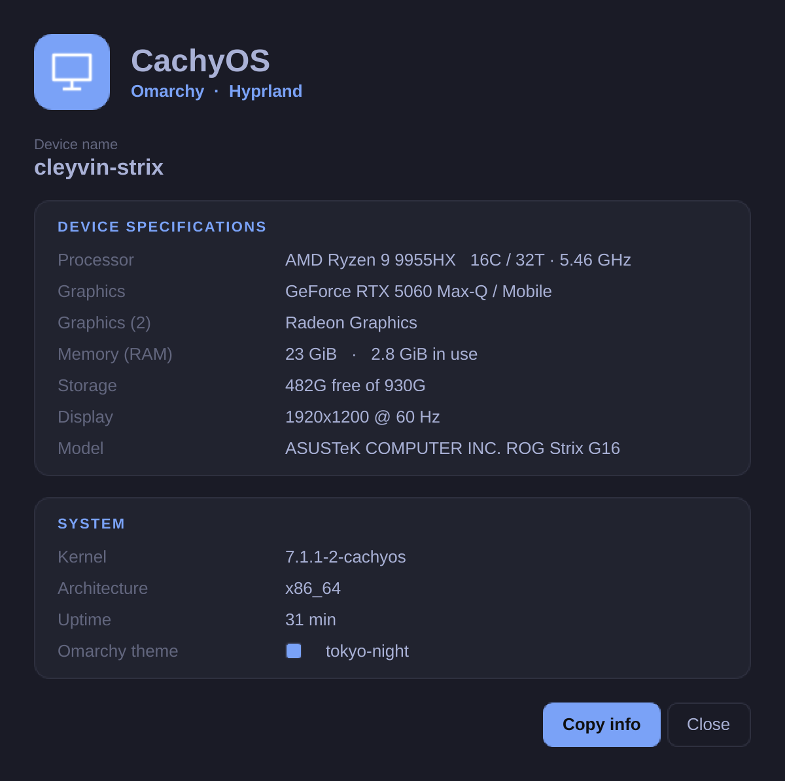
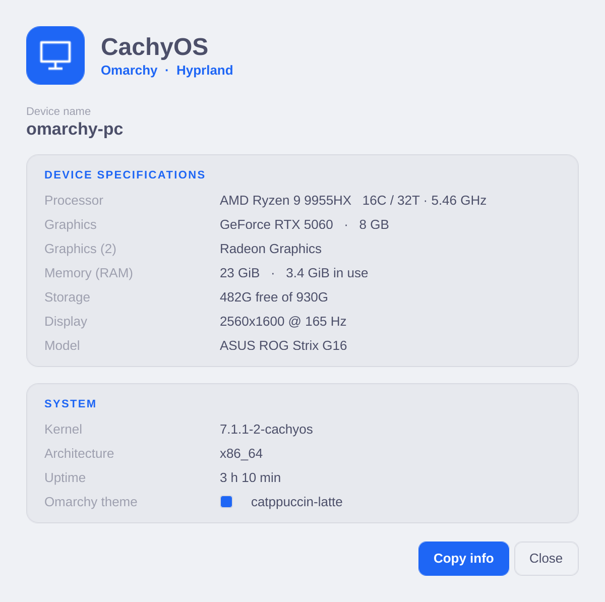
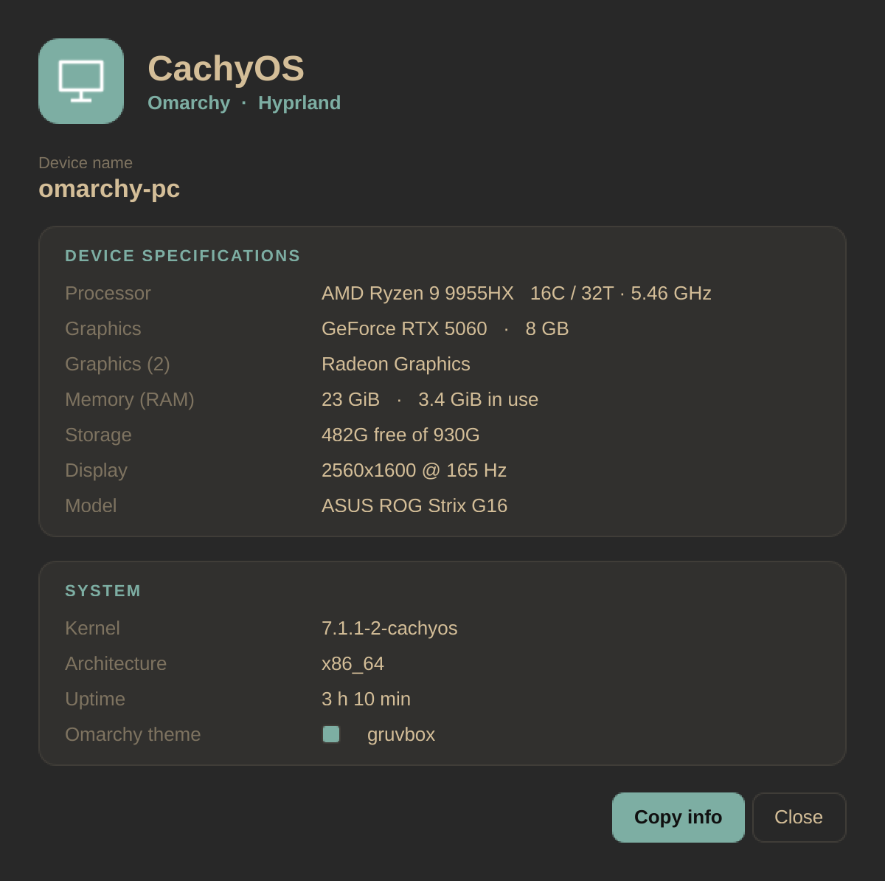
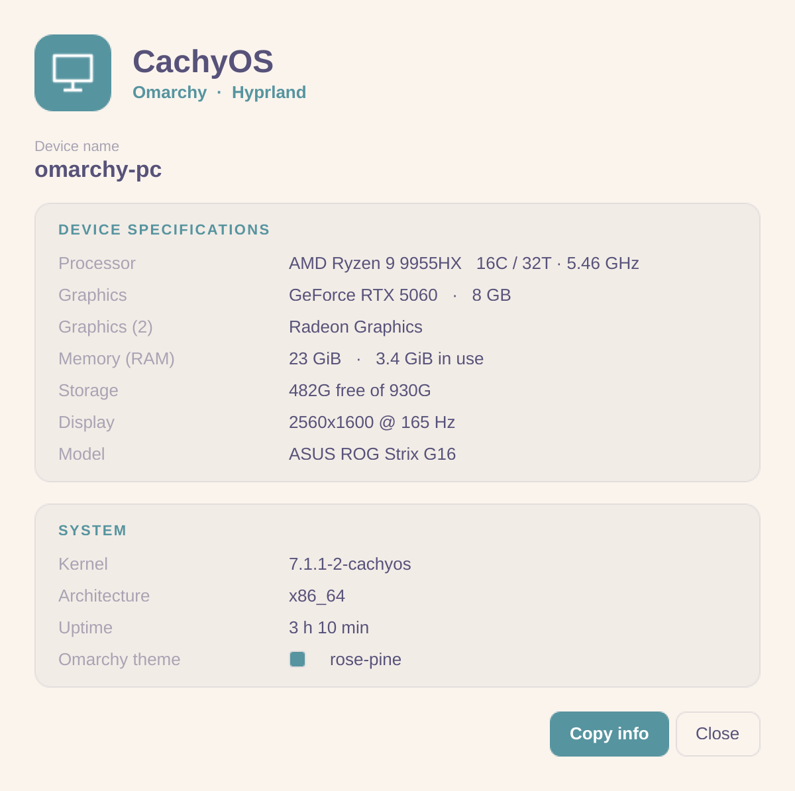
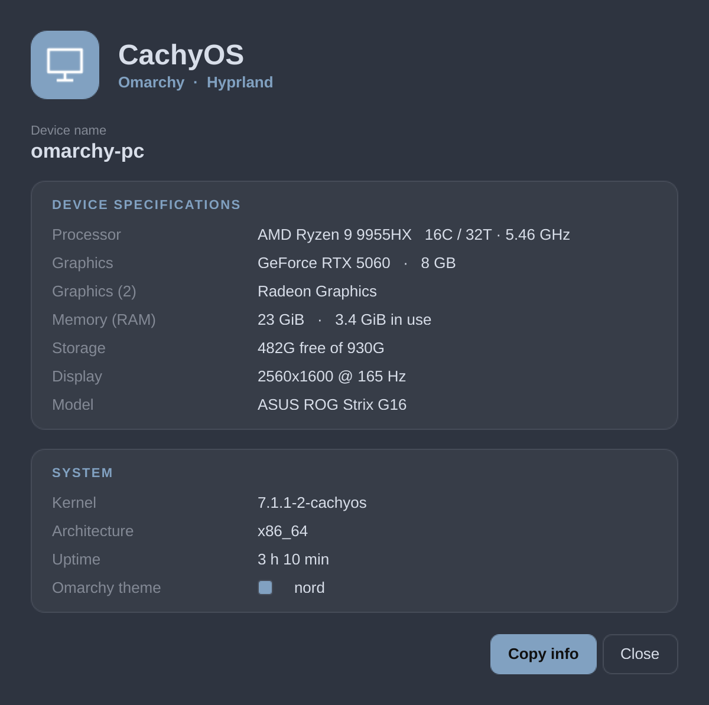

<div align="center">

# About This PC — for Omarchy

**A Windows‑style "About this PC" panel for [Omarchy](https://omarchy.org), built in Qt6/QML — that paints itself with your active Omarchy theme.**




</div>

---

## Why

Omarchy is gorgeous but minimal — there's no graphical "About this PC" like Windows or GNOME's *Settings → About*. So your CPU, GPU, RAM and OS live only behind terminal commands. **About This PC** brings that one‑glance hardware card to the desktop, and — the whole point — **it auto‑adapts to whatever Omarchy theme you're running**. Switch from Tokyo Night to Catppuccin Latte and the panel follows.

## Features

- 🎨 **Auto‑themed** — reads the colours of your *active* Omarchy theme (`colors.toml`) and uses them for background, text and accent. Works on dark **and** light themes.
- 🖥️ **Everything at a glance** — CPU (cores/threads/clock), GPU(s) + VRAM, RAM, storage, display, machine model, kernel, uptime, and the current theme.
- 🌍 **Bilingual, automatic** — interface follows your system locale (English / Spanish), no config.
- 📋 **Copy info** — one click copies a clean plain‑text summary to share in issues or forums.
- 🪶 **Light** — pure Qt6/QML, no Electron, no Python. Just `qt6-declarative`.

## Theme showcase

The exact same panel, on four different Omarchy themes — nothing configured, it just reads the active theme:

| Catppuccin Latte (light) | Gruvbox |
|:---:|:---:|
|  |  |
| **Rosé Pine** | **Nord** |
|  |  |

## Install

### Quick install (per‑user, no root)

```bash
git clone https://github.com/iCleyvin/omarchy-about.git
cd omarchy-about
./install.sh
```

Installs into `~/.local`. Launch it from your app launcher (search **"About This PC"**) or run `omarchy-about`.

### Arch / CachyOS package (system‑wide)

```bash
git clone https://github.com/iCleyvin/omarchy-about.git
cd omarchy-about
makepkg -si
```

### Requirements

- `qt6-declarative` (the `qml` runtime) — **required**
- `pciutils` (`lspci`) — GPU detection
- `nvidia-utils` *(optional)* — discrete GPU name + VRAM via `nvidia-smi`
- `hyprland` *(optional)* — live display resolution

## Usage

Run from a launcher, a terminal (`omarchy-about`), or bind a key. The window closes with **Esc** or the **Close** button.

### Bind a key (Hyprland)

```ini
bind = SUPER, I, exec, omarchy-about
```

### Make it float & center (Hyprland)

Qt windows tile by default; to show the card as a floating dialog add:

```ini
windowrulev2 = float,  title:^(About This PC|Acerca de este equipo).*$
windowrulev2 = center, title:^(About This PC|Acerca de este equipo).*$
```

## How it works

```
omarchy-about (bash)                main.qml (Qt6/QML)
───────────────────                 ──────────────────
collect OS / CPU / GPU / RAM …  ─┐
read active theme colours.toml   ├─► temp JSON ──► themed card
detect locale (en/es)           ─┘                 (XHR reads the JSON)
```

The launcher gathers hardware info (`lscpu`, `lspci`, `nvidia-smi`, `df`, `/proc`, DMI) plus the active theme's colours from `~/.config/omarchy/current/theme/colors.toml`, writes them to a temporary JSON file, and hands it to a small QML card. All presentation — layout, theming, language — lives in `share/omarchy-about/main.qml`. No daemon, no config files.

## Translations

The UI strings live in one dictionary at the top of `share/omarchy-about/main.qml` (`dict`). Adding a language is just another block of key/value pairs plus a case in the launcher's locale detection. PRs welcome.

## Uninstall

```bash
./uninstall.sh           # per-user install
# or, if installed via the package:
sudo pacman -R omarchy-about
```

## Contributing

Issues and PRs welcome — extra distros, more hardware sources, new translations, or theming tweaks. The whole thing is one bash script and two QML files; it's meant to be hackable.

## License

[MIT](LICENSE) © iCleyvin. Not affiliated with the Omarchy project; just built for it.
